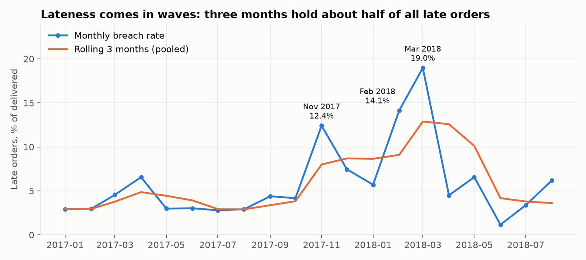
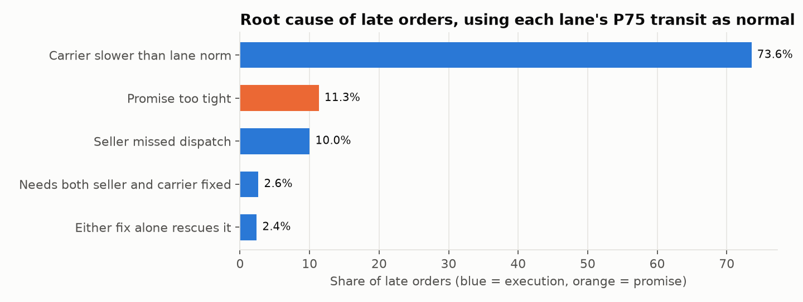

# E-commerce Delivery Performance & Seller Analytics

SQL-first analysis of about 100k marketplace orders. Author: Divyansh Rungta. Built 2026-10-31.

## The business question

As an operations analyst for a delivery marketplace: where are we missing delivery promises, which stage of the journey causes it, who or where is responsible, how much
does it hurt customers, and what should Operations do first? And the sharp version: **is lateness a promise-setting problem or an execution problem?**

**Answer: mostly execution, in the carrier stage, and it comes in waves.** This is an analysis of historic public data. No change was made to a live business.

## Key findings

Every number traces to [docs/RESULTS.md](docs/RESULTS.md).

1. **6.8% of delivered orders missed the promise** (6,534 of 96,470), and **88.7% of those were execution failures** that normal execution would have saved. The share ranged from 52.2% to
   96.0% across definitions of "normal", and stayed the majority each time.
2. **Three months hold 48.3% of late orders** on 21.6% of deliveries. Volume does not explain it alone: Jan 2018 orders rose 28.1% and breach fell, while Mar 2018 rose 7.2% and breach hit 19.0%.
3. **Sellers are not the main cause.** Only 27.8% of late orders had a missed seller deadline, and small sellers are no worse than others (6.6% under 30 orders, 7.1% for 500+).
4. **The same breach rate can hide different problems.** AL is late all the time (19.2% outside wave months). RJ is episodic (6.6% outside, 31.2% inside) and holds 22.9% of all late orders.
5. **Promises are padded and still miss.** 78.9% of orders arrive 7+ days early, yet adding 7 days to every estimate would still leave 3.0% late. The estimates are poorly targeted (correlation with actual days: 0.38).
6. **Lateness goes with low reviews, but most low reviews are not about lateness.** Mean review falls from 4.29 on time to 1.70 at 8+ days late (association), yet 67.5% of low reviews are on on-time orders.





## Recommendations

1. Pilot in-transit exception alerts in RJ, BA and ES ([design and sample size](docs/PILOT_PLAN.md)).
2. Build a peak-and-disruption playbook before the next Black Friday.
3. Fix promises on the lanes where they are the problem (AL, MA), avoid national padding, and apply a dispatch SOP to repeat-offender sellers.

Read the one-page [stakeholder memo](docs/MEMO.md).

## Dashboard

**Not yet built.** The Tableau Public workbook is a manual step: extracts and a [step-by-step guide](dashboard/BUILD_GUIDE.md) are ready, and no live link exists yet. The images above are static charts from `scripts/make_charts.py`.

## Approach

| Step | File |
|---|---|
| Load and data-quality views | `sql/01_load_raw.sql`, `sql/02_stg_data_quality.sql` |
| One-row-per-order fact table | `sql/03_fct_orders.sql` |
| KPI trends, ranking, rolling windows | `sql/04_kpi_trends.sql` |
| Anomalies against a trailing baseline | `sql/05_anomalies.sql` |
| Root-cause attribution | `sql/06_root_cause.sql` |
| Seller and category scorecards | `sql/07_seller_category_scorecard.sql` |
| Customer impact | `sql/08_customer_impact.sql` |
| Robustness tests | `sql/09_robustness.sql` |
| Pilot inputs, dashboard extracts | `sql/10_pilot_baseline.sql`, `sql/11_dashboard_exports.sql` |

SQL (DuckDB) is the primary deliverable. Python is used only for loading, charts and tests. Headline numbers are re-derived in pandas from the raw CSVs in `tests/test_project.py`.

## Reproduce

Needs Python `3.12` and Git Bash or any bash shell. Downloads the data, rebuilds everything, runs all tests and audits the numbers in the docs:

```bash
bash run_all.sh
```

## Data and licences

- **Data:** [Brazilian E-Commerce Public Dataset by Olist](https://www.kaggle.com/datasets/olistbr/brazilian-ecommerce), on Kaggle, licensed CC BY-NC-SA 4.0. Raw files are not stored here. The tables in `outputs/` are derived from it and carry the same licence: non-commercial use, with attribution, and share-alike.
- **Code:** MIT, see [LICENSE](LICENSE).

## Limitations

- No carrier names or tracking events: "carrier" means the pickup-to-customer stage, and the cause of the waves cannot be identified.
- Root-cause attribution is a model, and its size depends on the definition of normal transit (see finding 1).
- Survivorship: 1,737 open orders were past their promise. Counting them as late raises the breach rate to 8.4%.
- The defect measure is a proxy built from cancellations and low reviews. Review results are associations.
- No inventory, promotion or refund data, so inventory turns were not analysed and revenue leakage is limited to value at risk: R$ 269,735 on canceled or unavailable orders, and R$ 1,150,866 on late orders.
- The pilot is a design only, and its 33% target is a planning assumption.
- The Tableau formulas in the guide have not been tested in Tableau.

## Going deeper

[Learning guide](docs/LEARN.md) · [Metrics](docs/METRICS.md) · [Data quality](docs/DATA_QUALITY.md) · [Decisions](docs/DECISIONS.md) · [SQL skills](docs/SKILLS_CHECKLIST.md)
